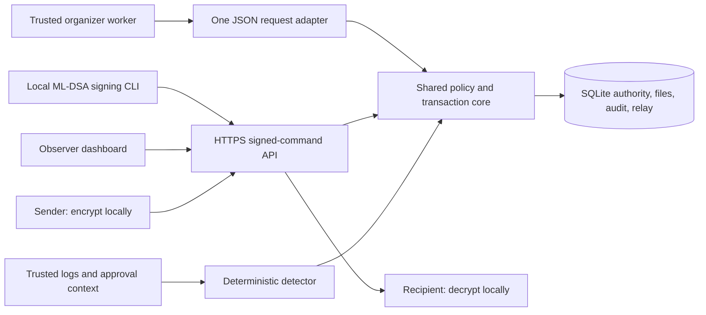

# Track 4: architecture, algorithms and assurance boundaries

This is the protected-file and encrypted-message implementation in `track4/`, not a mock adapter around the Go ledger. The root `track4_service.cjs`, HTTP API, operator CLI and dashboard use the same SQLite authority and policy functions. No organizer event IDs, labels, owners, keys, file contents or expected answers occur in the decision code. Limits and cryptographic domain identifiers are protocol parameters; deployment policy and detector baselines are explicit inputs.

The existing Go/PostgreSQL ledger, v1/v2 keys and historical evidence remain a separate, unchanged authority. Starting this service does not migrate, reset, re-enroll or replace them. Its independent protocol and conditional proofs remain in `PROTOCOL_V2.md` and `CRYPTOGRAPHY.md`.

## Components and trust boundaries

The worker asserts an actor through a trusted local process interface, as required by its contract. **That interface is not exposed over HTTP.** Network commands require ML-DSA-65 possession proofs. Browser observer tokens are read-only, short-lived and checked against current key/identity state on every use. Neither a CLI-supplied actor name nor a dashboard token authorizes administrative mutations by itself.

Node 24.11.1 supplies OpenSSL-backed ML-KEM-768, ML-DSA-65, AES-256-GCM, SHA-384, HMAC, HKDF and scrypt. `node:sqlite` supplies storage. There is no npm dependency installation, model download, hosted API or PostgreSQL requirement on the worker path. This is use of vetted primitives, not a claim of FIPS certification or an independently audited protocol.

## Authority and crash consistency

`BEGIN IMMEDIATE` serializes authentication, current policy, effects, nonce consumption and successful-operation audit insertion. SQLite WAL and `synchronous=FULL` persist the transaction before returning success. Each worker process reopens the same private state directory. Multiple local API/worker processes share that authority; there are no authorization caches or asynchronous replica decisions.

For a key `k`, authorization at time `t` requires an enabled actor, matching epoch, a registered unrevoked key, `not_before <= t`, and either no cutoff or `t < not_after`. The signature binds version, authority, actor, key fingerprint, epoch, nonce, expiry and complete operation body. The input parser rejects duplicate JSON fields, invalid UTF-8, lone surrogates, excessive nesting and unsafe numbers. Every SQLite-bound string is JSON encoded to preserve opaque identifiers including embedded NULs; this is a storage representation, not normalization of identity.

**Revocation argument.** Let `R` be the commit disabling an identity, and `E` a later protected effect. The exclusive transaction order forces `E` to read the disabled state after `R`; its predicate fails. Consequently there is no authorized effect whose authorization linearizes after `R`, assuming the database, runtime and policy code execute as specified. A response already committed before revocation may arrive later. Previously disclosed plaintext cannot be recalled.

**Atomic rotation.** A new key proves possession over the authority, target actor, current epoch, new public key and requested grace. One transaction installs that key, advances the actor epoch and cuts off every older key at `min(existing_cutoff, now + grace)`. A fresh request using an old key can operate during the declared grace; prior-epoch requests cannot. At the exact cutoff, the old key fails. Audit insertion or disk failure rolls back the whole change. An actual SIGKILL test interrupts an uncommitted rotation and verifies the old consistent version, file content and existing revocation after restart.

**Recovery.** Two distinct current admin/recovery identities approve an identical, expiring replacement proposal. Each approval binds the target epoch and new-key possession proof. The second approval rechecks the first approver's role, key lifetime, revocation and epoch. Completion retires all old target keys, installs the new one and increments the epoch atomically. A competing proposal from the earlier epoch fails. Self-approval is rejected. Recovery requires surviving authorized custodians; it does not solve loss of every administrative key.

Backward authority time fails closed. Request nonces are retained through expiry; protected-read challenge/key/resource tuples are retained as one-use records. A read correlation ID may be retried for the same actor/resource: every retry checks current policy, the audit lookup returns the latest decision, and immutable events retain both decisions. Reusing the ID for a different actor/resource is rejected. A previous allow result is never an authorization cache.

## Two distinct encryption workflows

### Organizer protected read

After checking file ownership and revocation:

`(ct, ss) = ML-KEM-768.Encaps(pk)`

`proof = hex_lower(HMAC-SHA-256(ss, UTF8(challenge || stored_body)))`

There is **no delimiter** in this organizer-defined concatenation. The public key and ciphertext use raw FIPS 203 representations and standard Base64. The HMAC is deliberately SHA-256 for wire compatibility; it does not change the SHA-384 commitments elsewhere. Independent `pqcrypto==0.4.0` decapsulation validates actual interoperability. This operation is a proof of possession of the encapsulated secret and exact file value, not an end-to-end messaging protocol.

### Client-to-client messages

The recipient generates a one-use ephemeral ML-KEM keypair in memory and signs an offer. It binds both actors, both pinned identity-key fingerprints, authority, offer ID, expiry and ephemeral public key. The sender verifies it against a separately trusted recipient key, encapsulates, and derives an AES-256 key:

`salt = SHA384(canonical(signed_offer))`

`info = SHA384(canonical(["KIG/message-key/v1", binding]))`

`K = HKDF-SHA384(ss, salt, info, 32)`

The binding contains the suite/version, authority, message and offer IDs, both actors/key fingerprints, expiry and KEM ciphertext. AES-256-GCM authenticates the binding as AAD with a fresh random 96-bit nonce. An ML-DSA signature also binds that header, nonce, authentication tag, ciphertext digest, length and chunk count. The receiver verifies the sender before accepting bounded chunks, then verifies the complete ciphertext and AEAD tag before releasing any plaintext.

The sender retries the same ciphertext, not fresh encryptions of a request with an uncertain outcome. The relay merges equal chunks, rejects conflicting chunks/message identities, and checks both peers against current authority. It stores ciphertext, never session secrets. Receivers accept reordered chunks, suppress duplicate chunks and reject a completed offer's reuse. Expired incomplete messages are discarded and report failure. The CLI makes at most five transport attempts; recipient acknowledgement is a separate operation from queue acceptance. There is no claim of exactly-once external file delivery across a crash between local output and acknowledgement.

**Conditional forward secrecy.** Later possession of a long-term signing key does not yield a completed message's ephemeral KEM private key or encapsulated secret. Receiver private KeyObjects are never serialized; references are discarded on completion, failure or close. This claim assumes ML-KEM security, authenticated peer-key pinning, uncompromised endpoints during the exchange, and effective native-runtime/OS cleanup. JavaScript cannot prove physical zeroization of native allocations or swap. No crash-resumable session secrets are saved; after a receiver restart, senders need a fresh offer. Session resumption is intentionally unsupported.

This is an application composition of standard primitives, not TLS/HPKE wire compatibility or a formally verified new cryptographic construction. HKDF transcript hashing is necessary for bounded context length. SHA-384's ideal collision work is approximately 2^192 classically, or 2^128 quantum queries under the usual collision model; these estimates do not prove uniform end-to-end security of the deployment.

## Storage, logs and backups

File encryption authenticates authority, asset, owner and version. The master key is a randomly generated 0600 file in a private 0700 directory; symlink/ownership checks and exclusive, synced installation prevent accidental overwrite or silent key regeneration. Database-only disclosure does not expose file bodies. A compromised host holding the master key is outside this protection.

Each audit event has an explicit sequence and JSON record boundary. Its SHA-384 chain commits to the preceding hash and structured event; an ML-DSA signature authenticates each chain link. Independent verification checks identity key, authority, order, time and optional external prefix anchor. Read allow/deny events commit with their decision records. Rejected network commands are separately best-effort logged as unauthenticated unless their key was cryptographically verified; an unavailable log never causes plaintext release. This log attests to the trusted authority's reports, not truthfulness of a compromised host or independent replay of client intent. The original Go ledger's replayable evidence is a separate format.

Identity backups and consistent logical authority snapshots use scrypt-derived AES-GCM encryption with random salt/nonce. Restore authenticates the envelope, validates private/public-key correspondence and file tags, and checks signed audit history against a separately retained anchor. Restore only creates a new directory. A complete older backup cannot pass an anchor that knows a later prefix. An unseen lost suffix cannot be inferred without independent retained knowledge. Snapshots are bounded at 128 MiB; excess size fails explicitly.

## Explainable detection

Inputs are immutable event IDs, source and receipt timestamps, measured offsets/uncertainty, approval records and an operator-supplied service-edge baseline. Labels are consumed only by the separate evaluator. Signed `detector.ingest` calls persist events and recompute the bounded report; conflicting reuse of an event ID fails.

Rules identify unapproved role changes, subsequent access in the same identity/session, allowed edges outside the baseline, grant-scope violations and connected unexpected service paths. The path rule groups by identity/session/flow and a configured time window; isolated denial alone does not establish lateral movement. Alerts cite identities, services, rule and supporting events. Late arrival can add an earlier prerequisite to an existing sequence.

Corrected time is `source_time - offset`. Every record retains its raw timestamp and interval `[corrected - uncertainty, corrected + uncertainty]`. Out-of-range offsets/delays and overlapping order are marked uncertain. `estimateClock` implements the four-timestamp offset/delay calculation; production observations must supply trusted measured timing, not pretend collector arrival equals event time. Public zero-uncertainty offsets are fixture metadata.

The evaluator reports an explicit event-level confusion matrix, F1, median receipt-derived alert delay and false-alerted events per 1,000 benign events. A perfect result on 22 public examples says nothing about unseen accuracy. Baselines are configuration, not learned models; no AI/ML is involved.

## Review scope and references

Tests exercise malformed encodings, actual process boundaries, key migration races, lost/reordered messages, tamper, corruption, current-policy checks, a real crash, independent KEM decapsulation and CLI/HTTP delivery. These are executable evidence and conditional arguments, not a mathematical proof of every code path. The single-authority topology requires a supported local filesystem; network-filesystem WAL, Byzantine replication, endpoint memory forensics, DDoS resistance and physical key custody are outside scope.

Primary implementation references: [Node 24.11.1 crypto](https://nodejs.org/download/release/v24.11.1/docs/api/crypto.html), [Node SQLite](https://nodejs.org/download/release/v24.11.1/docs/api/sqlite.html), [FIPS 203](https://csrc.nist.gov/pubs/fips/203/final). The organizer wire contract is pinned to [toolkit commit 8901dfb](https://github.com/ScalerOpenSourceLabs/Track-4-Toolkit/blob/8901dfbdbfe048853e0bfa25b60583d1e6617a63/docs/adapter-v1.md).
