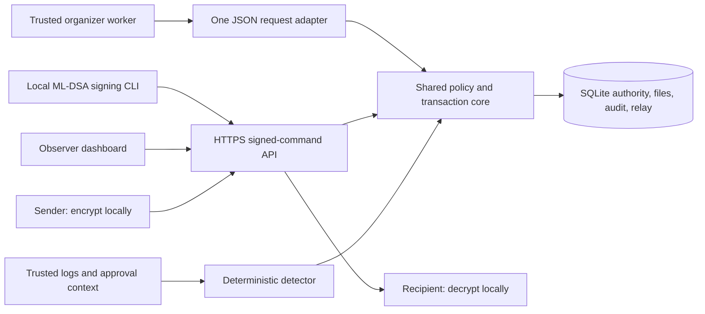

# Track 4: architecture, algorithms and assurance boundaries

This is the protected-file and encrypted-message implementation in `track4/`, not a mock adapter around the Go ledger. The root `track4_service.cjs`, HTTP API, operator CLI and dashboard use the same SQLite authority and policy functions. No organizer event IDs, labels, owners, keys, file contents or expected answers occur in the decision code. Limits and cryptographic domain identifiers are protocol parameters; deployment policy and detector baselines are explicit inputs.

An optional Go/PostgreSQL implementation is isolated under `legacy/`; it is not part of the Node judge path. Source relocation does not migrate deployed keys or state. Its protocol is documented under `legacy/docs/`. Repository history and third-party attribution are retained.

## Components and trust boundaries

The worker asserts an actor through a trusted local process interface, as required by its contract. **That interface is not exposed over HTTP.** Network commands require ML-DSA-65 possession proofs. Browser observer tokens are read-only, short-lived and checked against current key/identity state on every use. Neither a CLI-supplied actor name nor a dashboard token authorizes administrative mutations by itself.

Node 24.11.1 supplies OpenSSL-backed ML-KEM-768, ML-DSA-65, AES-256-GCM, SHA-384, HMAC, HKDF and scrypt. `node:sqlite` supplies storage. There is no npm dependency installation, model download, hosted API or PostgreSQL requirement on the worker path. This is use of vetted primitives, not a claim of FIPS certification or an independently audited protocol.

## Authority and crash consistency

`BEGIN IMMEDIATE` serializes authentication, current policy, effects, nonce consumption and successful-operation audit insertion. SQLite WAL and `synchronous=FULL` persist the transaction before returning success. Each worker process reopens the same private state directory. Local API/worker processes share the authority. Independent read nodes instead maintain separate encrypted caches and verified signed policy chains, with explicitly bounded stale access as described below. Trusted worker `setup` atomically replaces its scenario tables, generating a new authority/audit identity; malformed replacement rolls back. CLI initialization and network commands cannot invoke this reset.

For a key `k`, authorization at time `t` requires an enabled actor, matching epoch, a registered unrevoked key, `not_before <= t`, and either no cutoff or `t < not_after`. The signature binds version, authority, destination audience, actor, key fingerprint, epoch, nonce, expiry and complete operation body. The input parser rejects duplicate JSON fields, invalid UTF-8, lone surrogates, excessive nesting and unsafe numbers. Every SQLite-bound string is JSON encoded to preserve opaque identifiers including embedded NULs; this is a storage representation, not normalization of identity.

**Revocation argument.** Let `R` be the commit disabling an identity, and `E` a later protected effect. The exclusive transaction order forces `E` to read the disabled state after `R`; its predicate fails. Consequently there is no authorized effect whose authorization linearizes after `R`, assuming the database, runtime and policy code execute as specified. A response already committed before revocation may arrive later. Previously disclosed plaintext cannot be recalled.

**Atomic rotation.** A new key proves possession over the authority, target actor, current epoch, new public key and requested grace. One transaction installs that key, advances the actor epoch and cuts off every older key at `min(existing_cutoff, now + grace)`. A fresh request using an old key can operate during the declared grace; prior-epoch requests cannot. At the exact cutoff, the old key fails. Audit insertion or disk failure rolls back the whole change. An actual SIGKILL test interrupts an uncommitted rotation and verifies the old consistent version, file content and existing revocation after restart.

**Recovery.** Two distinct current admin/recovery identities approve an identical, expiring replacement proposal. Each approval binds the target epoch and new-key possession proof. The second approval rechecks the first approver's role, key lifetime, revocation and epoch. Completion retires all old target keys, installs the new one and increments the epoch atomically. A competing proposal from the earlier epoch fails. Self-approval is rejected. Recovery requires surviving authorized custodians; it does not solve loss of every administrative key.

Authority time advances from a wall-clock anchor using a monotonic process clock. A transient wall-clock jump cannot poison a running process. Native startup brackets three wall-clock samples with monotonic readings and uses the narrowest bracket. Its measured sampling uncertainty plus one millisecond of wall-clock quantization is merged forward to the persisted high-water time; this never extends an expiry. Larger regressions and explicitly injected clocks remain strict. Startup still requires time no earlier than the persisted high-water mark; clock repair is required if that trust assumption fails. Request nonces are retained through expiry; protected-read challenge/key/resource tuples have a configurable 120-second replay window. After that window the same opaque worker challenge can be used for a new encapsulation; applications must use fresh unpredictable challenges and reject stale replies. A read correlation ID may be retried for the same actor/resource: every retry checks current policy, the audit lookup retains the first decision, and immutable events retain all subsequent decisions. Reusing the ID for a different actor/resource is rejected. A previous allow result is never an authorization cache.

## Two distinct encryption workflows

### Organizer protected read

After checking file ownership and revocation:

`(ct, ss) = ML-KEM-768.Encaps(pk)`

`proof = hex_lower(HMAC-SHA-256(ss, UTF8(challenge || stored_body)))`

There is **no delimiter** in this organizer-defined concatenation. The public key and ciphertext use raw FIPS 203 representations and standard Base64. The HMAC is deliberately SHA-256 for wire compatibility; it does not change the SHA-384 commitments elsewhere. Independent `pqcrypto==0.4.0` decapsulation validates actual interoperability. This operation is a proof of possession of the encapsulated secret and exact file value, not an end-to-end messaging protocol.

### Client-to-client messages

The recipient generates a one-use ephemeral ML-KEM keypair in memory and signs an offer. It binds both actors, both pinned identity-key fingerprints, authority, offer ID, expiry and ephemeral public key. The sender verifies it against a separately trusted recipient key, encapsulates, and derives an AES-256 key:

`salt = SHA384(canonical(signed_offer))`

`info = SHA384(canonical(["KIG/message-key/v1", binding]))`

`K = HKDF-SHA384(ss, salt, info, 32)`

The binding contains the suite/version, authority, message and offer IDs, both actors/key fingerprints, expiry and KEM ciphertext. AES-256-GCM authenticates the binding as AAD with a fresh random 96-bit nonce. An ML-DSA signature also binds that header, nonce, authentication tag, ciphertext digest, length and chunk count. The receiver verifies the sender before accepting bounded chunks, then verifies the complete ciphertext and AEAD tag before releasing any plaintext.

The sender retries the same ciphertext, not fresh encryptions of a request with an uncertain outcome. The relay merges equal chunks, rejects conflicting chunks/message identities, and checks both peers against current authority. It stores ciphertext, never session secrets. Receivers accept reordered chunks, suppress duplicate chunks and reject a completed offer's reuse. Expired incomplete messages are discarded and report failure. The CLI makes at most five transport attempts; recipient acknowledgement is a separate operation from queue acceptance. There is no claim of exactly-once external file delivery across a crash between local output and acknowledgement.

**Conditional forward secrecy.** Later possession of a long-term signing key does not yield a completed message's ephemeral KEM private key or encapsulated secret. Receiver private KeyObjects are never serialized; references are discarded on completion, failure or close. This claim assumes ML-KEM security, authenticated peer-key pinning, uncompromised endpoints during the exchange, and effective native-runtime/OS cleanup. JavaScript cannot prove physical zeroization of native allocations or swap. No crash-resumable session secrets are saved; after a receiver restart, senders need a fresh offer. Session resumption is intentionally unsupported.

This is an application composition of standard primitives, not TLS/HPKE wire compatibility or a formally verified new cryptographic construction. HKDF transcript hashing is necessary for bounded context length. SHA-384's ideal collision work is approximately 2^192 classically, or 2^128 quantum queries under the usual collision model; these estimates do not prove uniform end-to-end security of the deployment.

## Storage, logs and backups

File encryption authenticates authority, asset, owner and version. The master key is a randomly generated 0600 file in a private 0700 directory; symlink/ownership checks and exclusive, synced installation prevent accidental overwrite or silent key regeneration. Database-only disclosure does not expose file bodies. A compromised host holding the master key is outside this protection.

Each audit event has an explicit sequence and JSON record boundary. Its SHA-384 chain commits to the preceding hash and structured event; an ML-DSA signature authenticates each chain link. Independent verification checks identity key, authority, order, time and optional external prefix anchor. Read allow/deny events commit with their decision records. Each first-decision row stores its signed event sequence plus a separately signed index binding; audit verifies both the index and corresponding event, so swapping in a later valid event cannot change the original result. Rejected signed-command attempts update a bounded 60-minute aggregate counter, not a signed event per request. Counters are operational telemetry, not an individual signed denial trail. The normal event budget defaults to 1,000,000 and can be increased through a signed admin command; reaching it stops ordinary data operations but cannot block revocation, rotation, recovery, role changes or backup. Physical disk/transaction failure still prevents a successful commit. Successful verification persists an ML-DSA-signed checkpoint in meta. Cold startup validates its authority/key-bound signature and verifies only the newer suffix; complete exported history remains independently verifiable. Cached-prefix verification assumes the already checked prefix is retained; it is not a rescan for retroactive disk tampering. This log attests to the trusted authority's reports, not truthfulness of a compromised host or independent replay of client intent. The optional Go ledger's replayable evidence is a separate format.

Identity backups and consistent logical authority snapshots use scrypt-derived AES-GCM encryption with random salt/nonce. Restore authenticates the envelope, validates private/public-key correspondence and file tags, and checks signed audit history against a separately retained anchor. Restore only creates a new directory. A complete older backup cannot pass an anchor that knows a later prefix. An unseen lost suffix cannot be inferred without independent retained knowledge. Snapshots are bounded at 128 MiB; excess size fails explicitly.

## Explainable detection

Input IDs and content are committed before normalization. Exact repeated events are skipped in both learning and detection. A reused ID with different content fails as `DUPLICATE_EVENT`, with `conflicting_duplicate` diagnostic metadata. Required fields remain strict; optional fields default; RFC3339 offsets and fractional seconds are accepted. Outcomes normalize case/whitespace through the default success/failure vocabulary plus `config.outcome_map` overrides. Unknown outcomes cannot assert successful access.

`learn(reference)` derives frequency-supported actor/role service edges from a separately reviewed earlier window, never labels. Role transitions do not depend on action names. Independent scoped approvals suppress expected changes; self-approval, successful post-revocation access and unexplained role changes alert.

Unusual edges form an undirected graph **per actor**, across session IDs. Sessions remain alert evidence. Defaults are a 30-minute window and 10-minute half-life. For a component at time t, `score = sum(2^(-(t-ti)/H))` over distinct service pairs. Mixed attempts require at least `lateral_min_edges` (default 3) and `1000*score >= lateral_score_milli` (default 2000). The two-successful-hop shortcut requires an ordered directed pivot A -> B -> C with three distinct services and strictly separated time-uncertainty intervals. Two spokes alone do not qualify. This shortcut bypasses the mixed-attempt score gate; otherwise two non-simultaneous edges could never reach the default score of 2. A sort-and-sweep index retains the newest eligible incoming events from two distinct origins per actor/destination; its exact witnesses are checked against exhaustive search. Prior reliable, unalerted successes on a trusted baseline route establish actor-specific familiarity for one movement window. Reuse is excluded only from the movement graph; independent role, revocation, approval and strict-baseline rules still run. See [the precision design and correctness argument](DETECTOR_PRECISION.md).

Union-by-size components update growing graphs incrementally; expired edges rebuild connectivity so stale bridges do not persist. Growing incidents append evidence rather than duplicate entire components per observation. Each event retains its first alert time for latency scoring. Large-fan-out regression covers 10,020 distinct edges and checks evidence size. Expiry-heavy graphs can still require repeated rebuilds; the offline budget is 100,000 events / 64 MiB and the API metadata budget is 16 MiB.

Both independent synthetic generators and their unchanged labels are reported in README. Three-edge unknown benign fan-out still produces false positives; two-edge spokes no longer invoke the ordered-pivot shortcut. All previously detected attack events remain detected across ten seeds per unchanged generator. The second generator retains isolated-attack misses. Neither result is production accuracy.

## Independent-node lease design and bound

A `replicator` credential is enrolled with one immutable node ID and audit public key. Sync checks both bindings, excludes admin/local-admin bypass, clamps the requested lease to policy `max_lease_ms` (default/max 5000), and commits an audit event for every export. A separate credential is required for every node. The authority signs `version, authority, node ID, challenge, node audit key, lease length, issuance time, checkpoint, audit suffix, policy, full/delta mode, base checkpoint, changed identities/keys/files and node-log acknowledgement` under a distinct ML-DSA domain. HTTPS protects the authorized replication channel. Every node pins the authority/audit public key out of band, verifies the contiguous signed chain from its retained checkpoint, persists its own policy log and encrypted snapshot, and runs the same pure command verifier as the authority. Since review-v5 each sync request must also be signed by the bound node audit key over the whole request, including a persisted, strictly increasing counter; the authority stores the highest accepted counter per node key. A stolen replicator credential without the node private key, or a captured request re-wrapped in a fresh envelope, is refused (`REPLICA_PROOF_REQUIRED`, `REPLAY`). The holder of both credentials can read all file plaintext. Each grant raises a lease horizon (issuance + lease/(1-rho), rho = 1%); every revoking change (revoke, rotate, role change, ownership transfer, completed recovery) returns it as `effective_everywhere_at_ms` (for rotation, no earlier than the old key's cutoff), and the CLI waits for it before reporting the change as effective on every node. Admin credentials can obtain it through an audited ownership transfer. Every sync export is audited; admin cannot use sync directly. These are trusted resource servers, not untrusted ciphertext-only relays.

The initial sync sends all records. Transactional SQLite triggers version actor/key/file changes with their audit sequence; subsequent grants include only records newer than the node checkpoint. The signed grant binds the exact base and result checkpoints. A node verifies continuity before atomically merging its encrypted snapshot, preserving unchanged records through restart. Startup never restores a lease. Schema 2 upgrades preserve keys/ciphertext and append one signed protocol-upgrade event without rewriting prior history; schema-1 binaries reject subsequent opens. old unbound replication credentials require a one-time administrator binding. No deletion operation exists for these replicated records; revocation is a versioned disabled/key-revoked state.

Each sync uploads up to 256 signed local read events after its last acknowledged cursor. The authority verifies the bound node key, chain continuity, source node and supported event fields, retains original signed events, and rejects gaps/forks. Duplicate uploads after a lost reply are idempotent. The acknowledgement is bound into the signed grant and the sync audit event. `audit` accepts a `node_id` to inspect imported reads; `detector.ingest` includes imported reads by default (explicit `include_replica_reads:false` opts out). A partition delays visibility of node evidence until reconnection; signed logs attest to a trusted node's reports, not truthfulness of a compromised node.

The node records a fresh challenge at monotonic time `m0`. A valid response must match that challenge and node identity; its deadline is `m0 + L`, never response-arrival time plus L. Delayed, replayed, wrong-node, tampered or forked grants cannot extend a lease. Each read checks lease validity before authorization, before transaction commit and before returning/queuing the response. Restart invalidates every lease until a fresh successful sync. Authentication time uses the authority's signed issuance time plus conservative elapsed time and a persisted high-water mark; local wall-clock changes do not extend grants. All local read decisions have their own signed node log, whose key is bound by the authority's grant.

**Conditional bound.** Let `r` be a committed revocation. Any grant carrying the pre-revocation policy was issued before `r`, and its challenge started no later than its issuance. If the node's monotonic clock progresses at rate at least `1-rho` relative to real time, that grant expires no later than `r + L/(1-rho)`. A newer grant either includes revocation or the node fails closed. Thus no new read authorization using the revoked credential occurs after this bound. With `rho=0`, it is at most L, including a total network partition. The requested `Delta+L` bound is a looser consequence; it is not evidence that a network message propagates through a partition. Normal connected convergence additionally depends on sync period, network delay and scheduling.

The bound concerns authorization/response queueing, not the time already-buffered bytes reach a remote recipient. It assumes an uncompromised authority/node and a monotonic clock that advances through suspension at the stated rate. A paused VM whose clock stops violates that assumption. Host wall-clock or measurement uncertainty, physical WAN behavior, Byzantine authorities, hardware clock certification and real-time scheduling are not proven. The five-process benchmark delays three sync transports and withholds two entirely; all five use different databases. Its median and max are five observed samples with polling delay, not a production SLA.

## Review scope and references

Tests exercise malformed encodings, actual process boundaries, key migration races, lost/reordered messages, tamper, corruption, current-policy checks, a real crash, independent KEM decapsulation and CLI/HTTP delivery. These are executable evidence and conditional arguments, not a mathematical proof of every code path. The authority and each independent cache require a supported local filesystem. Network-filesystem WAL, Byzantine replication, endpoint memory forensics, unrestricted DDoS resistance and physical key custody are outside scope.

Primary implementation references: [Node 24.11.1 crypto](https://nodejs.org/download/release/v24.11.1/docs/api/crypto.html), [Node SQLite](https://nodejs.org/download/release/v24.11.1/docs/api/sqlite.html), [FIPS 203](https://csrc.nist.gov/pubs/fips/203/final). The organizer wire contract is pinned to [toolkit commit 8901dfb](https://github.com/ScalerOpenSourceLabs/Track-4-Toolkit/blob/8901dfbdbfe048853e0bfa25b60583d1e6617a63/docs/adapter-v1.md).

## Signed destination and upgrade boundary

Commands and identity bootstrap use v2 signature domains and require `audience`: exactly `authority` at the authority, or the configured node ID at a replica. Missing audiences and v1 envelopes fail closed. The client/CLI obtain the audience from `/v1/context` at the target URL and keep it in signed identity details. TLS validates that endpoint; a single signed envelope cannot be replayed at a different node. Stop/restart every authority and replica process when deploying v2; an already running older binary cannot be retroactively changed by a schema marker. Existing identity keys remain valid with newly signed v2 requests. Stored audit events retain their original v1 audit domain; this change does not rewrite history.

Unowned resources have SQL NULL owners and cannot be read through owner authentication. Storage budget counts exact UTF-8 plaintext bytes, transactionally including replacements; ciphertext/SQLite overhead is additional. Transport/metadata remain 16 MiB, so a full snapshot with large identity metadata can exceed the transport budget before the plaintext budget; size for both constraints.

HTTP admission is four active requests per peer IP before the global 32-request bound. Header and body deadlines are five seconds, including clients that continue trickling bytes. A 250-ms header-timeout sweep and explicit initial-header/body timers enforce the limit; TLS handshake timeout is also five seconds. Rejected/error requests close their connection and admission is released on abort.
